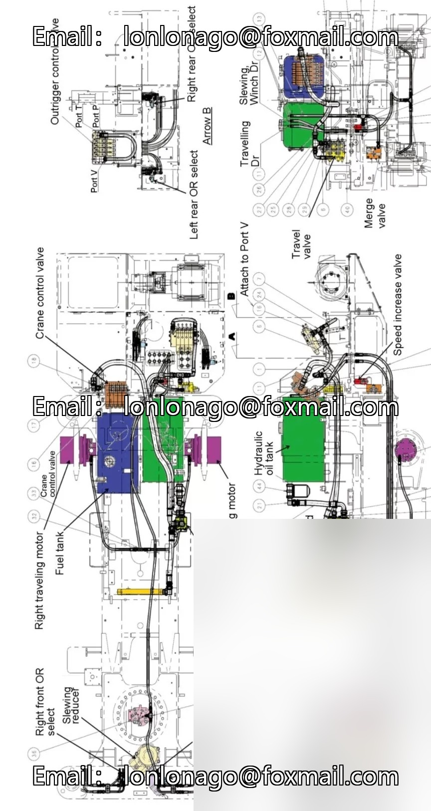
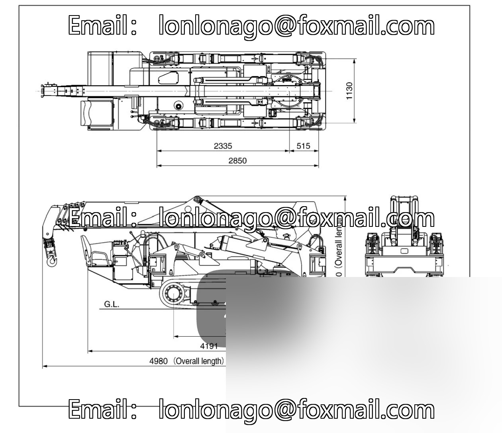
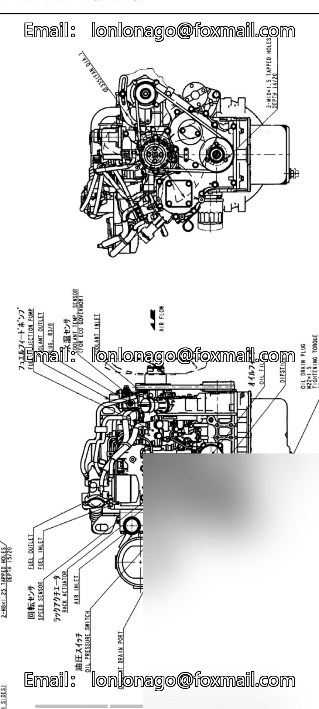
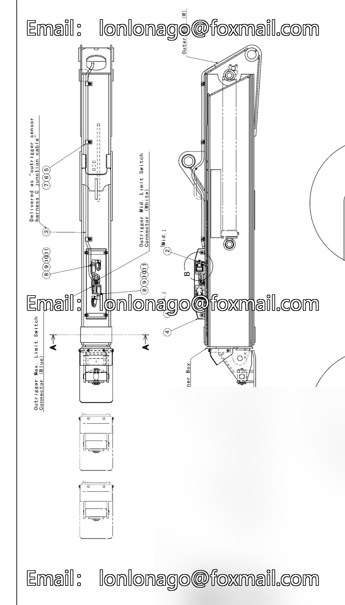

# MAEDA (Former Matsuda Manufacturers) MC405C-3 miniature crawler crane official maintenance

## Body

MAEDA (Maeda Manufacturing) MC405C-3 Micro Trapezoidal Cranes Official Repair Manual, PDF , 350 pages.
1. Content
1. Structure principles
2. Maintenance
3. Troubleshooting
4. Operation process
2. Characteristics of the materials
Authority: Originally released by the Japanese manufacturer, content is comprehensive, suitable for maintenance, maintenance, and reference for learning
non-returnable upon purchase
Directly requested, contact privately if there are questions
Maeda (Maeda) is a well-known manufacturer of mini-trapezoidal cranes in Japan, and this MC405C-3 belongs to its classic 4-ton small trapezoidal crane series
616914513

This is the official maintenance manual for MAEDA (Maeda) MC405C-3 miniature track crane, in PDF format with 350 pages, covering structure principles, maintenance, fault diagnosis and operation procedures, and is comprehensive for repair and learning.

<!-- AI_ENRICHED -->

## Images

## Payment

Here is a pay link on Stripe ( https://buy.stripe.com/3cs8yP7sY87d0vu9AB ). Please contact me lonlonago@foxmail.com after funding $89, and I will send you a complete data files , thank you!

